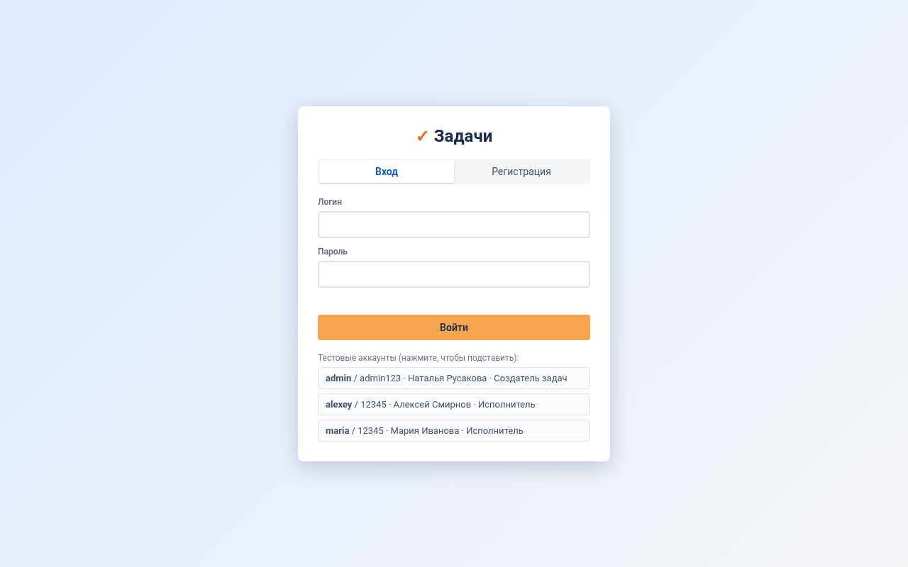
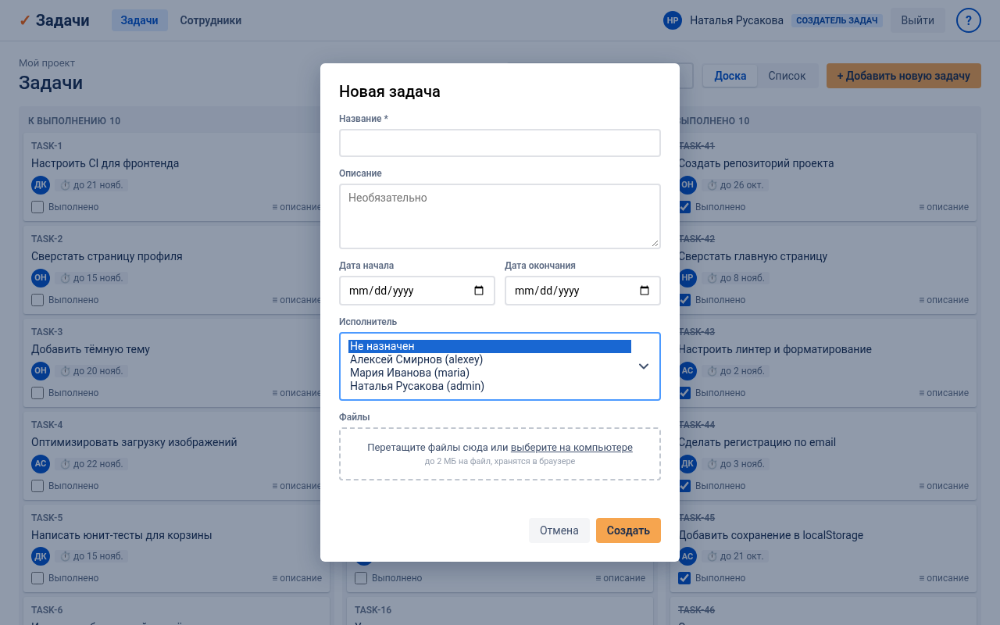
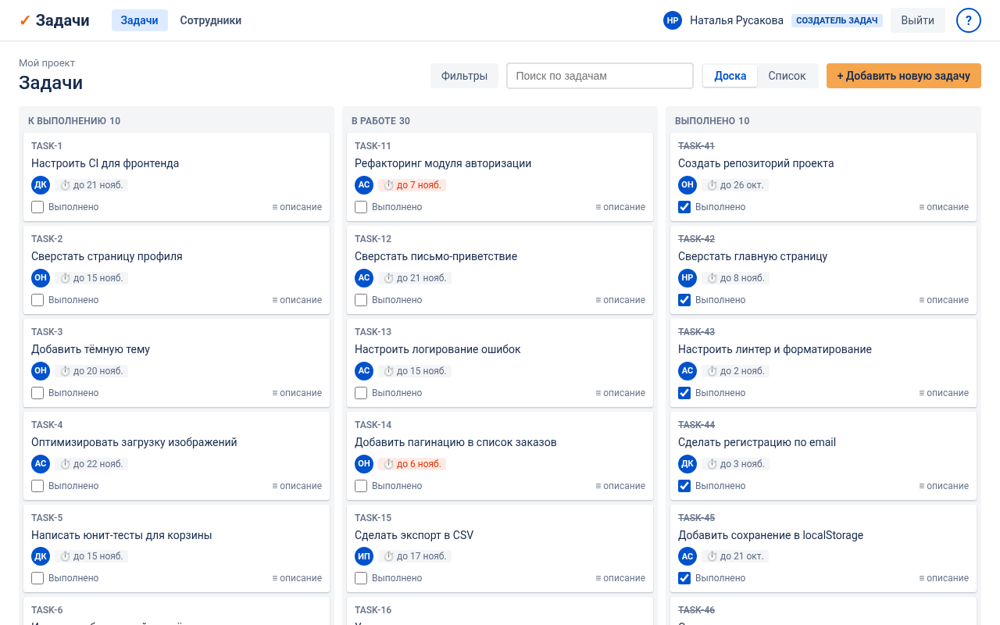
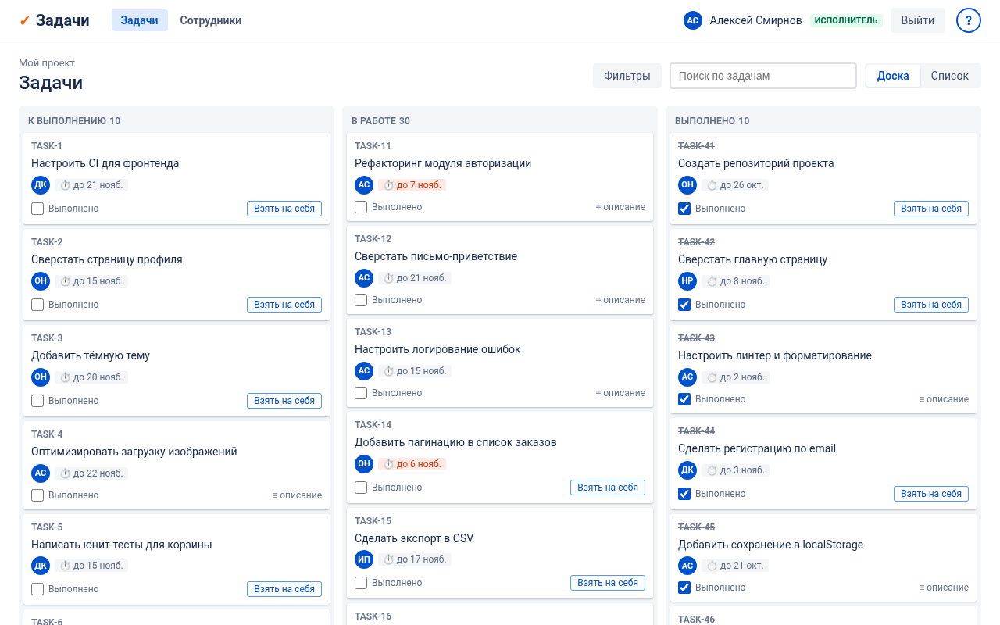
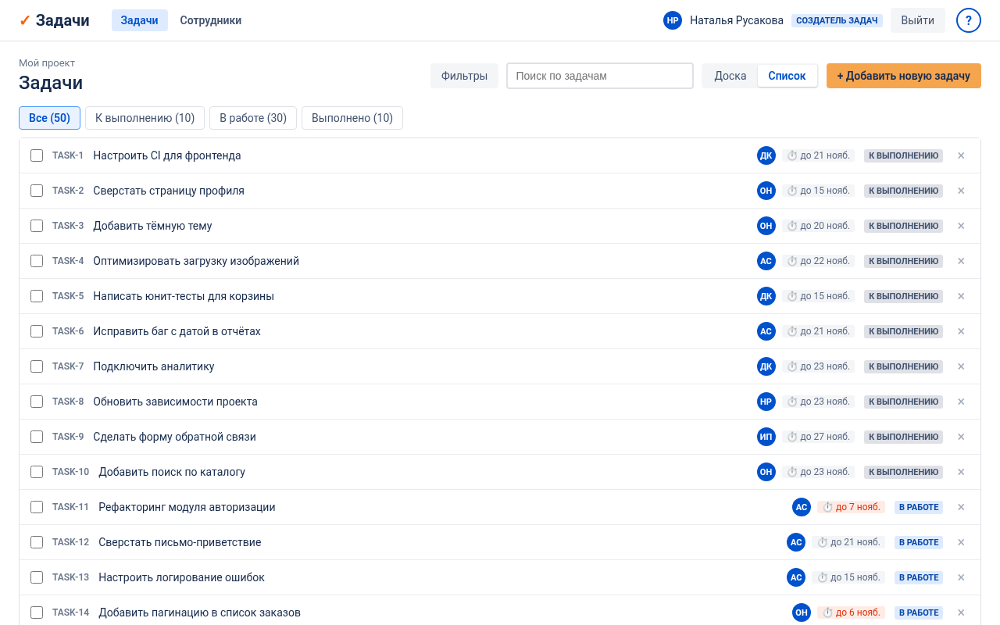
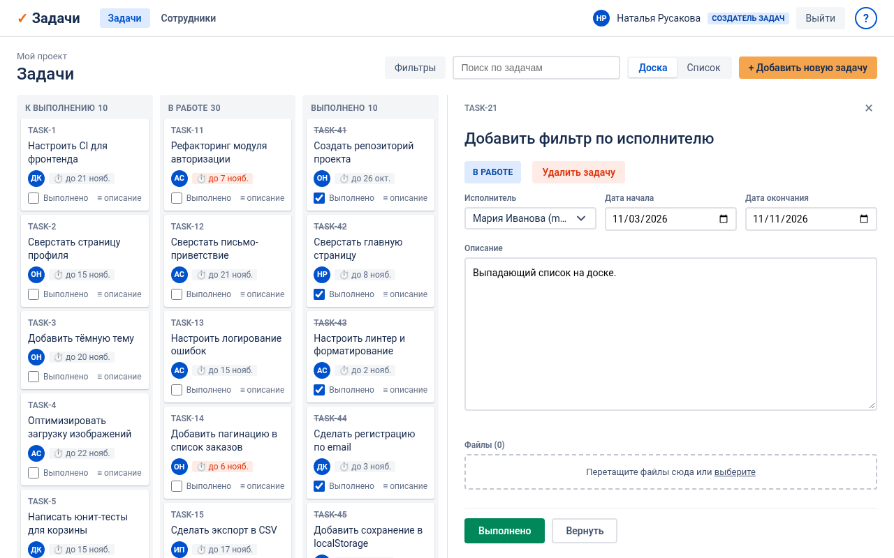
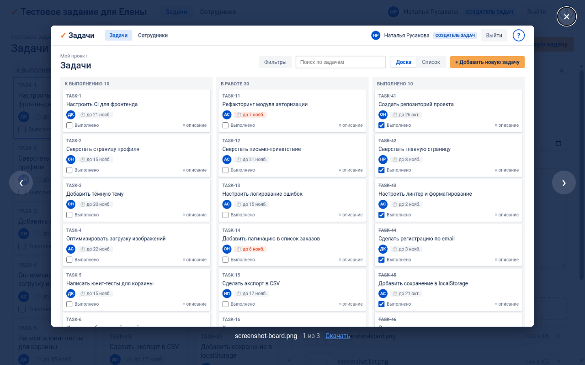
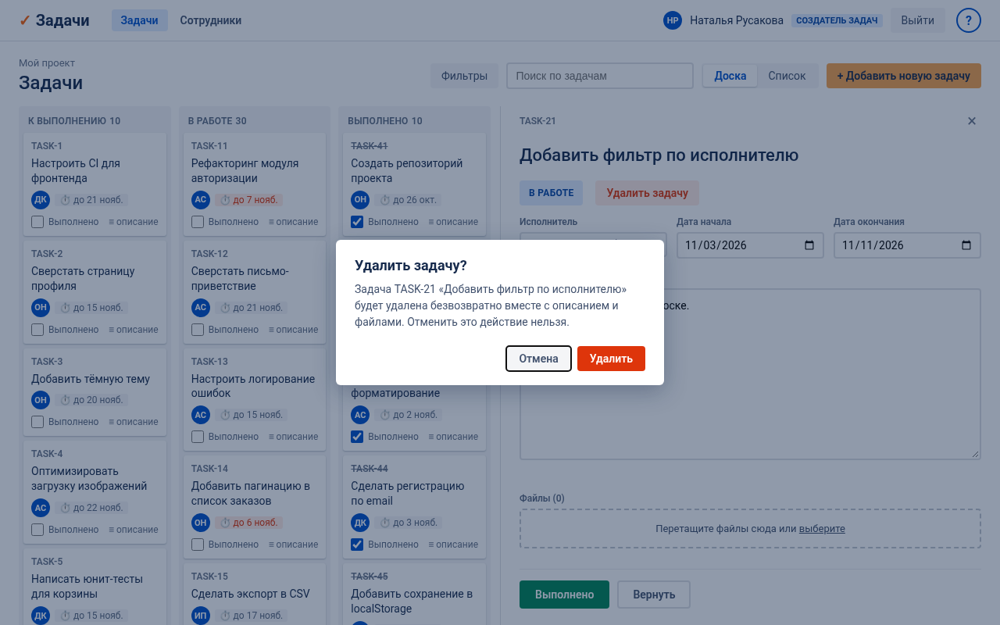
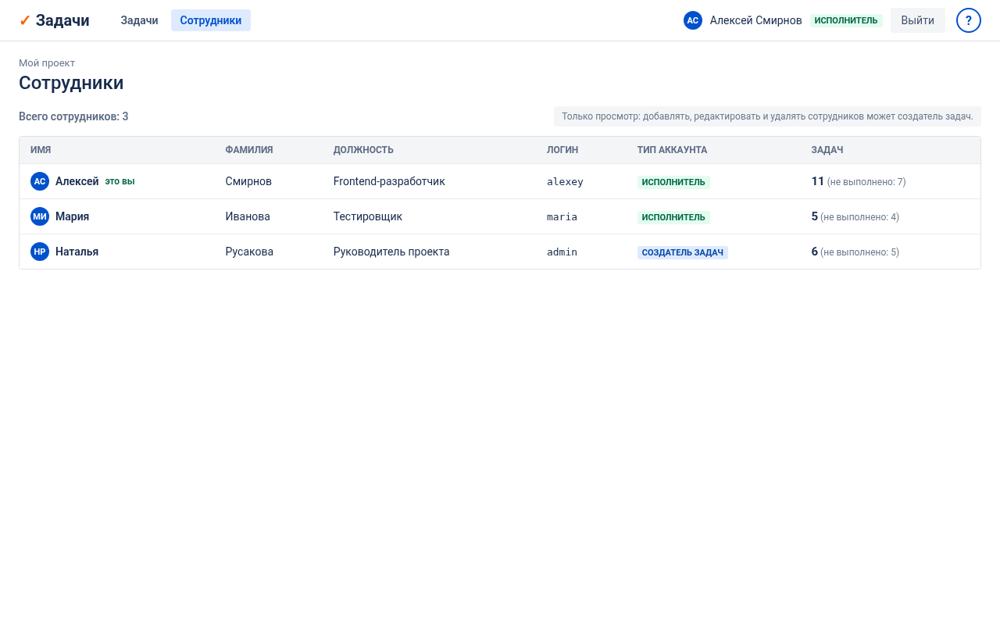
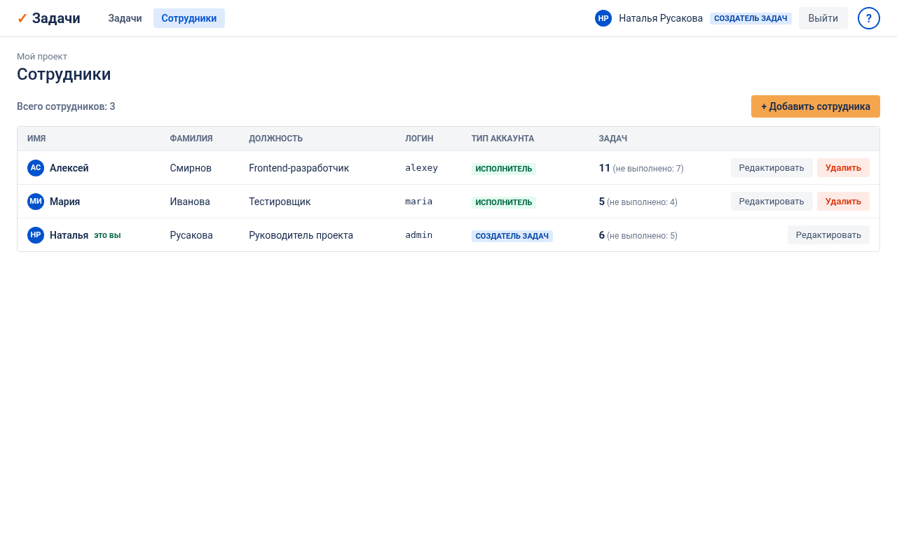

# Тестовое задание для Елены — канбан-доска задач

**Как запустить.** В папке проекта выполните `./start.sh` или `python3 server.py`, затем откройте http://localhost:8000. Не используйте `python -m http.server` и `python3 -m http.server`: адреса `/board`, `/list`, `/task/N`, `/employees` и `/help` тогда отдадут ошибку 404.

Простая доска задач, которая работает прямо в браузере. Сервер и база данных не нужны: все задачи хранятся в браузере (в localStorage) и не пропадают после обновления страницы.

Файлы проекта:

| Файл | Что в нём |
|---|---|
| `index.html` | разметка страницы |
| `style.css` | оформление |
| `script.js` | вся логика доски |
| `auth.js` | вход и аккаунты |
| `demo-data.js` | 50 тестовых задач |
| `server.py` | локальный сервер, который понимает адреса страниц |
| `start.sh` | скрипт запуска: `./start.sh` или `./start.sh 8080` |

## 1. Как открыть доску

Запускайте доску через `./start.sh` или `python3 server.py`, а не через `python -m http.server`: обычный сервер на адреса `/board`, `/list`, `/task/N`, `/employees` и `/help` ответит ошибкой 404.

1. Откройте терминал в папке проекта:
   ```bash
   cd /Users/alex/projects/to_do
   ```
2. Запустите локальный сервер:
   ```bash
   ./start.sh
   ```
   Это то же самое, что `python3 server.py`. Другой порт: `./start.sh 8080`.
3. Откройте в браузере адрес **http://localhost:8000**.

Чтобы остановить сервер, нажмите в терминале `Ctrl + C`. Если вы поменяли файлы, достаточно обновить страницу.

В шапке слева — название приложения и пункты «Задачи» и «Сотрудники». Справа сначала серая иконка справки (кружок с вопросом, подсказка «Справка»), затем имя и роль («Руководитель» или «Исполнитель» мелким приглушённым текстом, роль под именем по левому краю) и кнопка выхода с иконкой двери, без подписи (подсказка «Выйти»). Иконка справки открывает эту инструкцию отдельной страницей http://localhost:8000/help — с таблицами, списками и скриншотами. Пока справка открыта, иконка становится синей. Вернуться к задачам можно пунктом «Задачи» в шапке или кнопкой «назад» в браузере. Ссылку на справку можно открыть в новой вкладке или отправить коллеге.

### Адреса страниц

| Адрес | Что открывается |
|---|---|
| http://localhost:8000/board | доска |
| http://localhost:8000/list | список |
| http://localhost:8000/task/42 | карточка задачи TASK-42 поверх доски или списка |
| http://localhost:8000/employees | список сотрудников |
| http://localhost:8000/help | справка — эта инструкция |

При переключении «Доска / Список» и при клике на задачу адрес в браузере меняется сам. При закрытии карточки (крестик, `Esc` или «Вернуть») адрес снова становится `/board` или `/list` — в зависимости от того, где вы были. Кнопки «назад» и «вперёд» в браузере переключают виды и задачи. Просто http://localhost:8000 открывает последний выбранный вид.

Прямые ссылки работают только через `./start.sh` или `python3 server.py`: обычный `python3 -m http.server` на адрес `/task/42` ответит ошибкой 404, а `server.py` вместо этого отдаёт страницу доски.

На GitHub Pages прямые ссылки тоже работают: GitHub отдаёт на неизвестный адрес файл `404.html`, а он перенаправляет на главную страницу и передаёт ей нужный адрес. Сайт сам понимает, что лежит в папке репозитория (`https://логин.github.io/имя-репозитория/`), так что имя репозитория может быть любым. Пустой файл `.nojekyll` отключает обработку сайта движком Jekyll на GitHub.

## Вход и типы аккаунтов

При открытии доски сначала показывается экран входа. Есть два типа аккаунтов: **руководитель** и **исполнитель**. Права у них разные.



| Возможность | Руководитель | Исполнитель |
|---|---|---|
| Создавать задачи | да | нет |
| Редактировать название, описание, даты, исполнителя, файлы | да | нет, только просмотр |
| Удалять задачи | да | нет |
| Взять задачу на себя | назначает исполнителя в списке | да, кнопка «Взять на себя» |
| Перетаскивать задачи между колонками | да, сразу, без подтверждения | да, после подтверждения |
| Кнопки «Выполнено» и «Вернуть» в карточке | да | да |
| Смотреть список сотрудников | да | да |
| Создавать, редактировать и удалять сотрудников | да | нет |

Тестовые аккаунты (создаются при первом запуске):

| Логин | Пароль | Имя | Должность | Тип |
|---|---|---|---|---|
| `admin` | `admin123` | Наталья Русакова | Руководитель проекта | Руководитель |
| `alexey` | `12345` | Алексей Смирнов | Frontend-разработчик | Исполнитель |
| `maria` | `12345` | Мария Иванова | Тестировщик | Исполнитель |

На экране входа можно нажать на тестовый аккаунт, и логин с паролем подставятся сами. На вкладке «Регистрация» создаётся новый аккаунт: **имя**, **фамилия**, **должность**, **логин**, **пароль** и **тип аккаунта**. Справа вверху видно, кто вошёл, и есть кнопка «Выйти».

Аккаунты хранятся в браузере (ключи `todo-accounts` и `todo-session`), пароли сохраняются в виде хэша. Это локальная учебная авторизация в браузере, без настоящей защиты на сервере. От человека, который откроет инструменты разработчика, она не защищает.

## 2. Как добавить новую задачу

1. Войдите как руководитель и нажмите оранжевую кнопку **«+ Добавить новую задачу»** в правом верхнем углу.
2. Заполните форму:
   - **Название** — единственное обязательное поле.
   - **Описание** — подробности задачи, по желанию.
   - **Дата начала** и **Дата окончания** — выбираются в календаре. Дата окончания не может быть раньше даты начала.
   - **Исполнитель** — выпадающий список всех зарегистрированных аккаунтов в виде «имя (логин)», например «Мария Иванова (maria)». Можно оставить пункт «Не назначен». Аккаунты, созданные через регистрацию или на странице сотрудников, появляются в списке сами. Если у старой задачи указан исполнитель без аккаунта, в карточке он остаётся в списке с пометкой «(без аккаунта)», пока вы не выберете кого-то другого.
   - **Файлы** — перетащите файлы в рамку или нажмите «выберите на компьютере». Можно прикрепить несколько файлов, у каждого видно имя и размер. Один файл может весить не больше 2 МБ, потому что файлы тоже хранятся в браузере.
3. Нажмите **«Создать»**. Задача появится в колонке «К выполнению» и получит номер вида `TASK-51`.



Окно можно закрыть кнопкой «Отмена», клавишей `Esc` или кликом по затемнённому фону.

На карточке задачи видно номер, название, инициалы исполнителя, срок и сколько прикреплено файлов. Если срок прошёл, а задача ещё не выполнена, он подсвечивается красным.

Под аккаунтом исполнителя список исполнителей в карточке только для чтения: задачу он берёт кнопкой **«Взять на себя»**.

## 3. Как перетаскивать задачи между колонками

На доске три колонки: **«К выполнению»**, **«В работе»** и **«Выполнено»**. У каждой в заголовке написано, сколько в ней задач.



- Нажмите на карточку мышкой и, не отпуская, перетащите её в нужную колонку. Пока вы держите карточку над колонкой, та подсвечивается голубым. Отпустите кнопку, и задача поменяет статус. Если нужная колонка не видна (например, «Выполнено» за краем на узком экране), подведите карточку к краю доски — доска прокрутится сама. На сенсорном экране карточку можно перетащить пальцем.
- У **руководителя** перетаскивание срабатывает сразу, без дополнительного окна.
- У **сотрудников** (исполнителей) перед перемещением появляется окно с текстом «Вы уверены, что задачу нужно переместить по статусам?». Если подтвердить, задача переедет в новую колонку. Если нажать «Отмена», клавишу `Esc` или кликнуть по фону, задача останется на месте, а карточка (если она была открыта) не закроется.
- На доске закрыть задачу можно перетаскиванием в колонку «Выполнено» или зелёной кнопкой **«Выполнено»** в открытой карточке (с подтверждением). Галочки «Выполнено» на карточках доски нет — она осталась только в виде «Список».

Новый статус сохраняется автоматически.

Под аккаунтом исполнителя на чужих и свободных задачах видна кнопка **«Взять на себя»**. После нажатия исполнителем становитесь вы.



## 4. Переключатель «Доска / Список»

Справа вверху есть переключатель **«Доска | Список»**. Адрес при этом меняется на `/board` или `/list`.

- **Доска** — вид с колонками, как описано выше.
- **Список** — все задачи одной таблицей на всю ширину экрана. В каждой строке есть галочка выполнения, номер, название, исполнитель, срок, статус и крестик для удаления. Над списком есть фильтры по статусу: «Все», «К выполнению», «В работе», «Выполнено»; в скобках — количество задач с учётом поиска и фильтра по исполнителю. То же для счётчиков в заголовках колонок на доске.



Выбранный вид и фильтр запоминаются, и после обновления страницы (или по адресу http://localhost:8000) откроется тот же вид.

### Панель задачи

Клик по любой задаче, на доске или в списке, делит экран пополам: слева остаётся доска или список, справа открывается панель задачи, а адрес становится `/task/{номер}`. Например, http://localhost:8000/task/42 сразу открывает карточку TASK-42.

В открытой карточке можно:

- посмотреть или поменять название;
- увидеть текущий статус на цветной плашке: серая «К выполнению», синяя «В работе», зелёная «Выполнено». Это только отображение, статус через плашку поменять нельзя;
- поменять исполнителя в выпадающем списке и даты;
- написать или отредактировать описание (оно сохраняется прямо во время ввода);
- прикрепить, скачать или убрать файлы;
- удалить задачу (кнопка «Удалить задачу»).

Внизу карточки, под полем для файлов, две кнопки — с них же можно закрыть или вернуть задачу с клавиатуры:

- Зелёная **«Выполнено»** переносит задачу в колонку «Выполнено». Если задача уже там, кнопка неактивна и показывает «✓ Уже выполнено». Ею могут пользоваться и руководитель, и исполнитель.
- Белая **«Вернуть»** снимает исполнителя с задачи и закрывает карточку. Задача остаётся в своей колонке без исполнителя, и любой сотрудник может взять её кнопкой «Взять на себя». Адрес при этом возвращается на `/board` или `/list`.



Панель закрывается крестиком, клавишей `Esc` или кликом мимо неё. Клик по другой задаче открывает в панели её.

### Вложения и просмотр скриншотов

Файлы задачи видны внизу карточки. У PDF значок 📄, у архивов 🗜️, клик по ним скачивает файл. У скриншотов (PNG, JPG, GIF, WebP, SVG) есть миниатюра. Клик по миниатюре или имени открывает просмотрщик поверх страницы:

- если в задаче несколько скриншотов, их можно листать стрелками ‹ › по бокам или клавишами ← и → (по кругу), внизу видно «2 из 3»;
- ссылка «Скачать» сохраняет текущую картинку;
- закрыть просмотр можно крестиком, клавишей `Esc` или кликом по тёмному фону. Карточка задачи при этом остаётся открытой.



Тестовые вложения лежат в папке `attachments/` и добавлены в три задачи:

| Задача | Вложения |
|---|---|
| TASK-1 «Настроить CI для фронтенда» | 3 скриншота (`screenshot-board.png`, `screenshot-list.png`, `screenshot-task-card.png`), PDF `tz-kanban.pdf`, архив `design-assets.zip` |
| TASK-2 «Сверстать страницу профиля» | 1 скриншот `screenshot-employees.png`, файл `empty.txt` ровно в 1 байт |
| TASK-11 «Рефакторинг модуля авторизации» | PDF `test-report.pdf`, архив `logs.zip` |

Вложения добавляются один раз и только в те тестовые задачи, где ещё нет файлов. Если загрузить тестовые задачи заново через `?demo=1`, вложения тоже вернутся.

### Окна подтверждения

Перед несколькими действиями появляется окно в стиле доски:

- **«Удалить задачу»** предупреждает, что задача будет удалена вместе с описанием и файлами и отменить это нельзя. Кнопка «Удалить» в окне красная. То же окно появляется, если удалить задачу крестиком в списке.
- **«Выполнено»** спрашивает, перенести ли задачу в колонку «Выполнено».
- **«Вернуть»** показывает заголовок «Вернуть задачу в список» и текст «Задача снимется с вас, чтобы её мог взять любой другой из сотрудников».
- **«Взять на себя»** в открытой карточке спрашивает «Взять задачу на себя?». Кнопка «Взять» обычная, не красная. «Отмена», `Esc` или клик по фону оставляют исполнителя как был — задача не назначается.
- При **перетаскивании** у сотрудников — текст «Вы уверены, что задачу нужно переместить по статусам?».
- **«Выйти»** спрашивает «Выйти из аккаунта?» и показывает текст «Задачи сохранятся в браузере.». Кнопка «Выйти» в окне обычная, не красная. «Отмена», `Esc` или клик по фону оставляют вас в аккаунте.



Если нажать **«Отмена»**, клавишу `Esc` или кликнуть по фону, закрывается только окно подтверждения. Карточка задачи остаётся открытой, адрес `/task/…` не меняется, и само действие не выполняется.

## Сотрудники

Пункт **«Сотрудники»** в шапке (его видят все) открывает страницу http://localhost:8000/employees. На ней таблица всех аккаунтов: имя, фамилия, должность, логин, тип аккаунта и сколько задач назначено на сотрудника (в скобках — сколько из них ещё не выполнено). Если у сотрудника есть задачи, число в колонке «Задач» — ссылка: по нажатию открывается вид «Список» (`/list`) с фильтром по этому исполнителю. Фильтр виден в панели «Фильтры» и сбрасывается как обычно; кнопка «назад» в браузере возвращает на страницу сотрудников. Если задач ноль, число обычное, не ссылка. Новые аккаунты появляются в таблице сами.

Смотреть список могут все. Создавать, редактировать и удалять сотрудников может только руководитель. У исполнителя страница только для просмотра, без этих кнопок, с пометкой об этом.



Руководитель видит кнопку **«+ Добавить сотрудника»**. В форме есть имя, фамилия, должность, логин, пароль и тип аккаунта. Логин проверяется на занятость, пароль должен быть не короче 4 символов.

У каждого сотрудника есть кнопка **«Редактировать»**. В ней можно поменять имя, фамилию, должность, логин и тип аккаунта. Поле нового пароля необязательно: если оставить его пустым, пароль не изменится. Свой тип аккаунта поменять нельзя, чтобы случайно не лишиться прав. Если у сотрудника меняется имя, его задачи остаются за ним — исполнитель в задачах обновляется сам.

У каждого сотрудника, кроме себя, есть кнопка **«Удалить»** с окном подтверждения. Себя удалить нельзя. Задачи удалённого сотрудника остаются на доске, а он сам в них помечается «без аккаунта».



## 5. Поиск по задачам

Поле **«Поиск по задачам»** стоит в одной строке с заголовком. Ищет по названию, описанию и номеру задачи (например, `task-12`), без учёта регистра. Результат обновляется сразу во время ввода и работает в обоих видах. Чтобы показать все задачи снова, очистите поле.

## 6. Кнопка «Фильтры»: фильтр по исполнителю

Слева от поиска есть кнопка **«Фильтры»**. Она открывает панель со списком всех исполнителей и числом задач у каждого. Если есть задачи без исполнителя, в списке будет пункт «Без исполнителя».

- Отметьте одного или нескольких исполнителей, и останутся только их задачи.
- На кнопке появится число выбранных исполнителей, а сама кнопка подсветится, чтобы было видно, что фильтр включён.
- **«Сбросить»** снимает фильтр.
- Панель закрывается кликом в любом другом месте страницы.

Фильтр работает вместе с поиском, в обоих видах, и сохраняется после обновления страницы.

## 7. Доска с 50 тестовыми задачами

В проекте есть файл `demo-data.js` с 50 тестовыми задачами:

| Колонка | Задач |
|---|---|
| К выполнению | 10 |
| В работе | 30 |
| Выполнено | 10 |

У каждой задачи есть название, короткое описание, исполнитель (один из шести) и даты. У части задач в работе срок уже прошёл, поэтому он подсвечен красным.

Как ведёт себя доска с таким количеством задач:

- Колонки делят ширину экрана поровну и всегда стоят в один ряд. Длинная колонка «В работе» растёт вниз, страница прокручивается вертикально. Если три колонки не помещаются по ширине, горизонтально скроллится только сама доска — шапка, название, поиск и переключатель «Доска / Список» остаются на месте. При перетаскивании карточки к левому или правому краю доска прокручивается сама, чтобы можно было бросить задачу в колонку, которая была за краем экрана.
- На узком экране шапка уплотняется (на очень узком — в две ровные полосы, без поэлементного переноса): страница по ширине совпадает с экраном и не уезжает вбок.
- Когда открыта панель задачи на широком экране, все три колонки сужаются и помещаются в левой половине. На экране шириной меньше 800 пикселей открытая карточка закрывает доску целиком — слева колонки не остаются.
- Поиск и фильтр по исполнителю быстро сужают список. Например, в фильтре можно выбрать одного человека и увидеть только его задачи.

Тестовые задачи загружаются **один раз**, при первом открытии страницы. Потом можно спокойно менять, перетаскивать и удалять их, и после обновления страницы набор не перезапишется. Задачи, которые были до загрузки тестового набора, сохранены в браузере под ключом `todo-items-backup`.

Чтобы вернуть исходные 50 задач, откройте **http://localhost:8000/?demo=1**. Все текущие задачи заменятся тестовыми.

## Где хранятся данные

Всё хранится в localStorage браузера:

- `todo-items` — задачи;
- `todo-settings` — выбранный вид, фильтр по статусу и выбранные исполнители;
- `todo-demo-loaded` — отметка, что тестовые задачи уже загружены;
- `todo-demo-files` — отметка, что тестовые вложения уже добавлены;
- `todo-accounts` — аккаунты (пароли хранятся в виде хэша);
- `todo-session` — кто сейчас вошёл.

Данные привязаны к браузеру и адресу. В другом браузере или по другому адресу (например, на порту 3000 вместо 8000) доска будет пустой. Если очистить данные сайта в браузере, задачи и аккаунты пропадут. Вход — это локальная проверка в браузере, а не защита на сервере.

## Известные ограничения

Это учебное приложение, часть ограничений оставлена специально:

- сессию можно подменить через `localStorage` (`todo-session`) — это не серверная авторизация;
- при регистрации и в форме сотрудника логин проверяется по-разному: в регистрации допускается кириллица, в форме сотрудника — нет;
- исполнитель в задаче хранится по имени, а не по логину, поэтому двух однофамильцев не отличить;
- карточки и строки списка открываются только мышкой, с клавиатуры поддержка частичная (в открытой карточке статус можно сменить кнопками «Выполнено» и «Вернуть»);
- окно сотрудника не закрывается кликом по фону;
- на экране шириной меньше 800 пикселей открытая карточка полностью закрывает доску.
